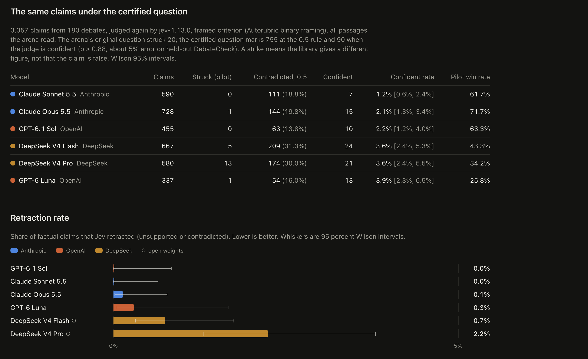

# TribunaLLM

Two language models debate a motion. A third model, TypeSafe's decision model Jev, checks every finished sentence against a reference library the debaters never see and strikes it through while the next sentence is still arriving. The same engine, run headless over many models, produces a leaderboard of which model is contradicted least.

<p align="center">
  <a">
    
  </a>
  <br>
</p>

Paper: [`paper/TribunaLLM.pdf`](paper/TribunaLLM.pdf)

## What this repository shows

The arena's first tournament failed as a measurement: in 180 blind debates between six frontier models the judge struck 20 of 3,357 claims, and when one number was altered in 78 sentences it had approved, it caught none. The failure became the instrument.

- **DebateCheck.** Every approved sentence with a number becomes a pair, the original and a copy with the number changed, so the altered copy is wrong by construction. 1,164 numeric pairs plus 1,657 pairs with a changed country, source, direction word or unit. Holding the model and the passages fixed and changing only the question, the same Jev goes from catching one altered number in twenty to nine in ten when the criterion is posed in Autorubric's binary framing.
- **A pre-registered study of six judges.** Two decision models of different makers, three chat models and an NLI classifier answer the same criterion over the same passages, and grade two rubric panels with human labels. Two chat models of different families share most of their errors and are worth 1.16 independent votes; a decision model with a chat model, or two decision models, are closer to independent. Part of the shared error is shared evidence. The framing that helps Jev makes the second decision model worse, so a criterion has to be tuned to the judge that answers it. Two of five predictions failed and are reported.
- **The leaderboard the arena promised.** The same 180 debates judged again with the certified question: 90 confident strikes instead of 20, with the two Claude models and GPT-6.1 Sol struck least.



The pre-registration, with its deviations and verdicts, is [`docs/preregistration-judge-correlation.md`](docs/preregistration-judge-correlation.md); the held-out report is [`bench/debatecheck/STUDY.md`](bench/debatecheck/STUDY.md).

## Run it

```bash
git clone https://github.com/Duss02/TribunaLLM.git
cd tribunallm
pnpm install
cp .env.example .env.local   # TYPESAFE_API_KEY for the judge, plus a key for the debaters
pnpm dev                     
```

Keys can also be pasted on the Settings page; they stay in the browser and are used for that visitor's requests only. `JEV_MOCK=1 pnpm dev` runs a complete debate with a fake judge and scripted debaters, for trying the interface without keys. `/gui` is the same debate as a 3D courtroom, `/leaderboard` the ranking, and `/?auto=1&pack=sugar-tax&pro=gpt-6-luna&con=gpt-6.1-sol` starts a debate on load.

## How a sentence is judged

In blind mode, the default, the debaters argue from what they know. The judge holds the evidence: a curated pack of verified passages per motion and a library of whole Wikipedia articles. Each finished sentence goes to Jev with the twenty passages that best match it, in two requests sent in parallel: five typed questions (is it a checkable claim, is it supported, which passage, is it on the motion, how does the evidence relate to it) and the contradiction criterion that decides a strike, posed in Autorubric's framing:

> Determine whether this criterion is satisfied by the `submission`. Criterion: A passage in the evidence gives a different number, date, name, place or outcome for the same thing the sentence describes, or states the opposite.

A sentence is contradicted at p >= 0.7, supported at p >= 0.7, an opinion when p(claim) < 0.5, and otherwise unverified, which costs nothing because silence in a library the debater never saw says nothing about the claim. A contradicted sentence is struck and costs two points, a supported one earns one; a turn-level request scores rebuttal and relevance; a final request picks the stronger case. In strict mode a strike also rewinds the turn that is still streaming. The thresholds were set before any data was collected. The exact questions, the scoring table, the tournament flags and the caveats are in [`docs/details.md`](docs/details.md).

## Reproduce the benchmark and the study

```bash
pnpm tournament --models a,b,c --packs all    # run debates, bench/results/*.jsonl
pnpm leaderboard:build                        # match outcomes and ratings
pnpm debatecheck:build && pnpm debatecheck:build-types   # the contrastive pairs
pnpm debatecheck:jev                          # Jev under seven ways of asking
pnpm debatecheck:decisions                    # GPT-6 Luna through the Decisions API
pnpm debatecheck:llm --judge deepseek-v4-pro  # a chat judge under the same criterion
pnpm debatecheck:study --heldout              # the pre-registered analysis, bench/debatecheck/STUDY.md
pnpm debatecheck:study-tables                 # the paper's tables and macros
pnpm leaderboard:v2                           # the stored claims under the certified question
```

HHEM and the Autorubric runs are Python (`scripts/debatecheck/judge_hhem.py`, `autorubric_validate.py`). The whole study, pilot included, cost under 30 USD of API credit at list prices; `pnpm debatecheck:study-spend` recounts it. The human validation of the construction labels is prepared in [`bench/debatecheck/human/`](bench/debatecheck/human/) and not yet collected.

## Layout

- `app/`, `components/`: the arena, the courtroom and the leaderboard pages (Next.js).
- `lib/debate/`: the orchestrator, retrieval, events; `lib/jev/`: the judge, its questions and the criterion; `lib/scoring/`: the rules.
- `packs/`: evidence packs and the Wikipedia libraries; `bench/`: results, DebateCheck, panels, reports.
- `scripts/`: tournament, leaderboard, DebateCheck and study scripts; `paper/`: the manuscript.

## Caveats

- A strike means the library gives a different figure, not that the claim is false; the pilot's review found edition conflicts (a 2024 cost range against the pack's 2026 edition) among them.
- Only sentences the judge had approved were perturbed, so the benchmark's sample is selected by the judge; a sample from sentences it had not approved is the next step.
- Six English-language motions, six debaters, two held-out motions: a small world. Costs are list prices.


## License

MIT, see [LICENSE](LICENSE). The reference libraries in `packs/library/` are text from English Wikipedia under CC BY-SA 4.0; each file lists the articles, URLs and revisions it was built from. See [CONTRIBUTING.md](CONTRIBUTING.md) to add a pack or a model and [DECISIONS.md](DECISIONS.md) for the choices that were not obvious.
